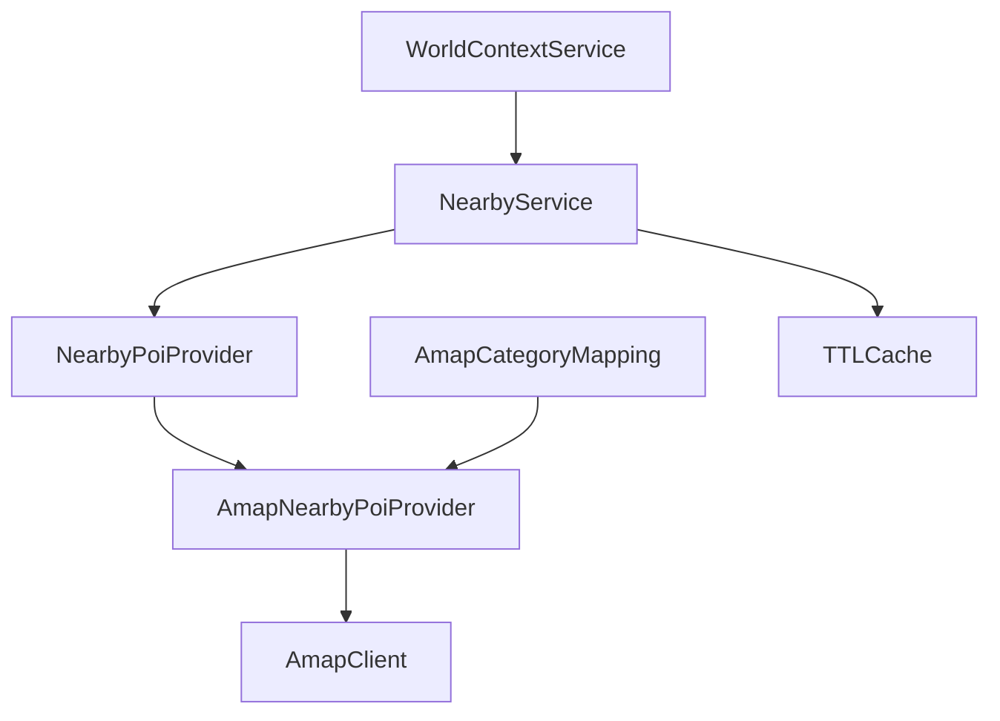

# TraceMate Phase 3B_3 — Nearby Services 验收报告

**READY**。当前 Phase 3B_3 及七类扩展 Addendum 均已完成。STOP，等待人工验收；未进入 Phase 3B_4。

## Summary

支持当前位置或 Core POI 附近的七类实时服务设施：RESTAURANT、CAFE、TEA_DRINK、DESSERT_ICE_CREAM、CONVENIENCE_STORE、RESTROOM、MALL。生产 Core 保持58项；Service POI是临时世界观察，不变为Core或路线站点。

Phase3A、3B_1、3B_2冻结实现保持。用户在3B_3任务书确认3B_2为FROZEN，该状态已记入PHASE3B_2_FREEZE.md；原候选archive保留历史内容。

## Architecture

新增NearbyService、ServicePoi DTO、NearbyServiceCategory、NearbyPoiProvider / BatchNearbyPoiProvider，以及独立provider分类配置。复用已有AmapClient、LocationService官方转换、TTLCache及opening parser，不改Trip或RouteEngine。默认七类合并为四组around请求；营业/评分/费用/电话随business字段返回，没有逐店detail或全上海text搜索。

## Service POI Contract

ServicePoi字段：provider、provider_poi_id、service_poi_id、name、primary_category、categories、category、provider_type/typecode、location/coordinate_system、distance_m/distance_type、address、tel、rating、cost、opentime_today/week、open_status、data_status、fetched_at、status_evaluated_at、classification_source。所有结果GCJ02，缺动态字段保留null；开放时间无法可靠解析时UNKNOWN。评分没有补0，费用没有推断。

身份形如amap:B0…，不使用Core stable ID；不写data/pois.json，不进入Core Repository、RouteEngine候选池、walk zones、cultural knowledge、TripState、must-go、visited或RouteVersion stop。商场的Service身份与徐家汇商圈Core AREA完全分开。

每次返回一份全局去重results，以及各category独立排序的category_result_ids。前端按ID引用展示，每类最多limit项；同咖啡兼甜品门店可以出现在两个分类视图，但实体只在results出现一次。category_counts按分类视图统计，不按inventory中的categories重复累计。

预留FOOD_AND_DRINK、ESSENTIALS、REST_AND_SHELTER展示分组；本阶段没有UI、图片或评论。

## Search Origin

| 输入 | 搜索原点 |
| --- | --- |
| current GPS WGS84 | 复用LocationService → 原有AmapWalkingProvider官方转换 → GCJ02 |
| current GPS GCJ02 | 使用当前坐标，不重复转换 |
| POINT Core（p28） | 有效routing coordinate |
| AREA Core（p35） | repository已有route_anchor overlay；不取identity point或polygon中心 |
| LINEAR Core（p34） | 推荐入口anchor；不取identity point或secondary出口 |

GPS和Core同时传入时GPS优先；GPS转换失败返回UNAVAILABLE，不偷偷fallback到Core。没有GPS时调用者可将当前路线Core ID或显式Core ID传入。p35身份NOT_FOUND不阻塞Nearby，也不查询Core的provider detail。

## API / Compatibility

推荐入口：`WorldContextService.search_nearby_services(location=None, core_poi_id=None, categories=None, radius_m=800, limit_per_category=5, *, current_location=None)`。categories=None默认七类；半径1–3000m，每类limit1–10。invalid origin/category/radius/limit拒绝，不发请求。

保留`search_nearby_rest_stops`兼容wrapper，统一转发新入口；NearbyRestStopService是NearbyService兼容别名，旧四类显式调用保持能力。ServicePoi/ServicePoiCategory保留，另提供NearbyServicePoi/NearbyServiceCategory。未修改TripCommand NLU。

详细契约见docs/PHASE3B_3_API_CONTRACTS.md。

## Category Mapping

| 类别 | Provider映射 / 约束 |
| --- | --- |
| RESTAURANT | 0501/0502/0503/0504；精确050000普通餐饮返回值也支持 |
| CAFE | 0505；不将所有饮品店归为咖啡 |
| TEA_DRINK | 从0506/0507/0508/0509或050000等粗分类候选识别现代茶饮；先看结构化奶茶/果茶/茶饮证据，再用受类型约束的名称/品牌fallback |
| DESSERT_ICE_CREAM | 0507/0508/0509统一冰淇淋/甜品/烘焙类，不无限细分 |
| CONVENIENCE_STORE | 0602；061200专营店、超市不属于此类 |
| RESTROOM | 精确200300/200301/200302/200303；200304及母婴室类型排除 |
| MALL | 精确060101；060100仅有明确购物中心/综合体类型时接受；排除普通商场、单体百货、免税店、写字楼、商业街 |

配置见data/amap_service_categories.json。依据[高德官方分类表](https://lbs.amap.com/api/webservice/download)，核验摘录保存在examples/nearby_rest_stops/category_reference.json。接口及business字段依据[高德POI 2.0文档](https://lbs.amap.com/api/webservice/guide/api-advanced/newpoisearch)。

TEA_DRINK没有伪造为唯一正式typecode。传统茶馆/茶艺馆在没有现代茶饮证据时不变为bubble tea；明显医院或餐厅type不被名字“奶茶”覆盖。NAME_FALLBACK会显式记录，属于推断分类，其他动态字段仍完全来自provider。咖啡兼甜品使用多categories，primary保持CAFE。

本次真实样本发现200304母婴室被厕所父类召回、部分百货标为购物中心。已收紧规则并补做对应验证；原始观察保留在live_acceptance_initial.json，最终修正结果在live_acceptance.json，未擦除真实问题证据。

## Query Efficiency / Cache

七类分为MEALS、DRINKS_AND_DESSERT、ESSENTIALS、MALLS四组，每组一次/v5/place/around；page_num=1，page_size最多25，show_fields=business。不跨页，不逐店detail。只搜索缺失缓存类别的对应组；非batch provider保留旧单类别适配路径，默认Amap实现使用batch。

TTL=300s，复用容量512的LRU防御性复制缓存，key含provider、完整规范化origin、category、radius、limit。没有GPS量化，不为缓存改变距离语义；失败不缓存。Cache只保存观察，每次重算open_status；跨上海日期不复用旧today hours。

AVAILABLE表示所有查询成功，0结果合法；PARTIAL表示部分查询失败或损坏记录；UNAVAILABLE没有假设施fallback。单店data_status=PARTIAL仅表示缺少动态字段，不等同于整个query失败。error仅固定safe code。

## Ranking

各category独立：OPEN → UNKNOWN → CLOSED，再按distance升序、同距离rating有值在前且降序，最后service_poi_id稳定打破平局。不比较不同category谁更好。CLOSED不按开放状态删除，但仍受每类limit限制。

距离优先有效非负provider值，否则已有Haversine；distance_type显式区分，二者都不声称walking距离。异常返回的实际坐标或距离超出半径时过滤。厕所缺时间UNKNOWN，不假定全天开放；周营业文字不猜测。

## Live Acceptance

一次完整七类验收：3个场景、12次around、1次官方GPS转换、0次detail，缓存重复查询新增0请求。随后仅对真实样本暴露并修正的RESTROOM/MALL重查3个场景，共6次around。其他五类保留原真实观察；总计18次around、1次转换、0次detail，没有重复完整live套件。

### A_CURRENT_GPS

Origin：31.15805826823, 121.464558919271，GCJ02；source=CURRENT_LOCATION；radius=800m；status=AVAILABLE。

| Category | Count | Top results：名称 / 距离 / open status / data status / rating / cost |
| --- | ---: | --- |
| RESTAURANT | 5 | 野渡WildDock(西岸梦中心店) (35m / UNKNOWN / PARTIAL / 4.5 / 147.0)；西塔老太太泥炉烤肉(Gate M西岸梦中心) (105m / UNKNOWN / AVAILABLE / 4.5 / 118.0) |
| CAFE | 5 | Chili's奇利斯美式小餐馆(西岸梦中心1F层) (115m / UNKNOWN / PARTIAL / 4.6 / 131.0)；密丘咖啡店 (245m / UNKNOWN / PARTIAL / 2.8 / null) |
| TEA_DRINK | 1 | 爷爷不泡茶NOYEYENOTEA(上海传媒港GWALK店) (365m / CLOSED / AVAILABLE / 4.0 / 13.0) |
| DESSERT_ICE_CREAM | 5 | BeanStar比星咖啡(上海徐汇国盛大楼店) (229m / UNKNOWN / PARTIAL / 3.8 / 28.0)；春鹿秋鹿茶冰室 (270m / UNKNOWN / PARTIAL / 3.0 / null) |
| CONVENIENCE_STORE | 5 | 公路商店(西岸梦中心店) (187m / OPEN / PARTIAL / 4.6 / null)；7-ELEVEn(龙文路店) (335m / UNKNOWN / PARTIAL / 3.8 / null) |
| RESTROOM | 5 | 无障碍洗手间(Gate M西岸梦中心) (150m / UNKNOWN / PARTIAL / null / null)；女卫生间(Gate M西岸梦中心) (150m / UNKNOWN / PARTIAL / null / null) |
| MALL | 1 | Gate M西岸梦中心 (359m / CLOSED / PARTIAL / 4.9 / null) |

### B_P28_WEST_BUND

Origin：31.167682, 121.463841，GCJ02；source=CORE_POI；radius=800m；status=AVAILABLE。

| Category | Count | Top results：名称 / 距离 / open status / data status / rating / cost |
| --- | ---: | --- |
| RESTAURANT | 5 | 迈志豪食堂 (423m / UNKNOWN / PARTIAL / 2.9 / null)；食一荟 (471m / UNKNOWN / AVAILABLE / 4.7 / 491.0) |
| CAFE | 5 | Vuoiuna Caffe(西岸梦中心店) (180m / UNKNOWN / PARTIAL / 3.2 / 30.0)；追觅咖啡 (417m / UNKNOWN / PARTIAL / 3.7 / null) |
| TEA_DRINK | 1 | 喜茶(GATEM西岸凤巢店) (573m / CLOSED / AVAILABLE / 4.3 / 17.0) |
| DESSERT_ICE_CREAM | 5 | 光明冷饮铺(西岸听风台) (578m / UNKNOWN / PARTIAL / 4.0 / 12.0)；Craving Dessert Co.(GATE M西岸凤巢店) (544m / CLOSED / AVAILABLE / 4.1 / 59.0) |
| CONVENIENCE_STORE | 1 | 罗森(滨江城开中心一店) (392m / CLOSED / PARTIAL / 4.1 / null) |
| RESTROOM | 5 | 洗手间 (15m / UNKNOWN / PARTIAL / null / null)；公共厕所 (327m / UNKNOWN / PARTIAL / null / null) |
| MALL | 1 | Gate M西岸梦中心 (739m / CLOSED / PARTIAL / 4.9 / null) |

### C_P35_XUJIAHUI

Origin：31.193781, 121.438463，GCJ02；source=CORE_POI；radius=800m；status=AVAILABLE。

| Category | Count | Top results：名称 / 距离 / open status / data status / rating / cost |
| --- | ---: | --- |
| RESTAURANT | 5 | 左庭右院鲜牛肉火锅(徐汇TPY店) (108m / OPEN / AVAILABLE / 4.4 / 133.0)；谷子情时尚智选餐厅 (62m / UNKNOWN / PARTIAL / 3.3 / 34.0) |
| CAFE | 5 | SHONENJUMPCAFE(上海店) (113m / UNKNOWN / PARTIAL / 3.2 / 123.0)；库迪咖啡(徐家汇地铁站店) (63m / CLOSED / AVAILABLE / 4.0 / 9.0) |
| TEA_DRINK | 1 | SUNNSIP上昔茶铺(美罗城店) (128m / CLOSED / AVAILABLE / 3.8 / 23.0) |
| DESSERT_ICE_CREAM | 5 | 巧克力店 (120m / UNKNOWN / PARTIAL / 2.3 / null)；顾二叔·手作酸奶(上海徐汇TPY店) (70m / CLOSED / AVAILABLE / 3.8 / 18.0) |
| CONVENIENCE_STORE | 2 | LAWSON罗森(东方商厦店) (58m / UNKNOWN / PARTIAL / 4.1 / null)；道诡异仙迷惘便利店快闪店(TPY中心) (113m / CLOSED / PARTIAL / 3.8 / null) |
| RESTROOM | 5 | 女洗手间(东方商厦旗舰店) (87m / UNKNOWN / PARTIAL / null / null)；无障碍洗手间(东方商厦旗舰店) (87m / UNKNOWN / PARTIAL / null / null) |
| MALL | 2 | 美罗城 (146m / CLOSED / PARTIAL / 4.8 / null)；上海港汇恒隆广场 (151m / CLOSED / PARTIAL / 4.9 / null) |

p35始终保持NOT_FOUND，实际origin是31.193781,121.438463的route_anchor。所有样本provider ID、坐标、距离与跨类去重已校验。完整样本包含被请求参数和经脱敏/字段白名单筛选的provider观察，不包含key或传输URL。

## Mutation Audit

实时验收前后：TripState完整快照一致，RouteVersion数组一致；Core Repository raw数据、所有routing坐标、Core/identity/spatial JSON的SHA-256均一致。只读服务没有TripStore依赖，不会insert、must-go、visited、replan、refill或产生版本。

基线逐文件审计：旧src/tests/scripts/data文件仅 `src/services/world_context_service.py` 被扩展；新增六个源码模块。其余旧源码和生产数据完全一致。Core=58，p40未恢复；API key扫描无泄露。见examples/nearby_rest_stops/delivery_audit.json。

## Tests

- 开发targeted：Nearby58项 + Location35项 + Spatial24项，共117项PASS。分类最后收紧后仅验证相关58项，PASS。
- 最终full offline：一次，共821项，816通过，5项opt-in live跳过，75.463s。
- 最终完整Nearby live：一次，1/1测试PASS，覆盖GPS/p28/p35七类场景。
- 随真实provider分类问题做的targeted live：仅RESTROOM、MALL，三个场景全部PASS。未重复旧Walking/Location/Calibration/Spatial live模块；这些API实现未变化。
- full offline完成后只有新Service分类mapping修正与文档/证据整理，按Testing Policy仅补相应targeted验证，没有再跑全历史suite。

日志及计数见examples/nearby_rest_stops/regression_summary.json、targeted_regression.txt、final_offline_regression.txt、final_live_regression.txt、targeted_live_correction.txt。

## Known Limitations

- 依赖高德实时召回和分类；商业类型可能粗糙，rating/cost/tel/opening可能缺失或过时。UNKNOWN不是关闭，CLOSED也不是实时到店保证。
- TEA_DRINK的受类型约束名称fallback是分类推断，显式标记；传统茶馆不无条件归为奶茶。
- MALL保守排除含百货/商厦等名称及类型，可能遗漏名称带这些词的真实综合体；宁可少召回，避免把单店/办公楼当综合服务空间。
- 每组最多25个候选，不做全量分页；类别稀疏或被近邻其他细类占据时可能不足limit或0结果，不造数据补齐。
- 两次真实观察合成最终分类视图时，各POI保留各自fetched_at，可能来自不同分钟；不是同一秒全城市快照。
- Provider/Haversine距离均不是walking路线；商场存在不表示可全天休息、避雨或使用内部设施。
- Service POI暂不进入路线；没有detour、第三方评论、图片、UI或新增药店/医院/超市等类别。

## Ready for Phase 3B_4?

**READY**。本轮STOP，等待人工验收。未实现Weather或Route Reality Check，未开始Phase3B_4。
