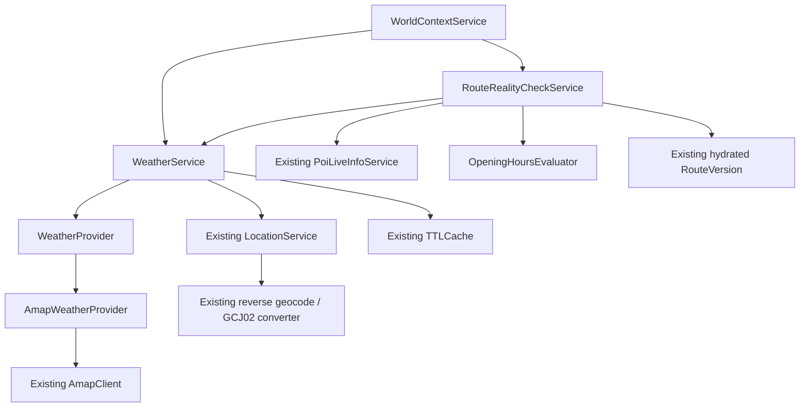

# TraceMate Phase 3B_4 — Weather Awareness & Route Reality Check

## Summary

**READY**。Weather Awareness 与 Route Reality Check 已完成，七类结构化 warning、针对性测试、一次最终完整离线回归、一次最终完整 live 验收全部通过。交付状态为 **READY_PENDING_HUMAN_ACCEPTANCE**。STOP，等待人工验收，未进入 Phase 4A。

用户在本轮任务书确认 Phase 3A、3B_1、3B_2、3B_3 均为 FROZEN。本轮只增加观测层。Core 保持 58；无自动删除、重排、must-go 修改、visit-mode 切换、Replan、TripStore 写入、CAS 或新 RouteVersion。

接口契约：[`docs/PHASE3B_4_API_CONTRACTS.md`](../../contracts/PHASE3B_4_API_CONTRACTS.md)。确定性证据：[`offline_warning_audit.json`](../../../examples/weather_reality/offline_warning_audit.json)。完整 live 证据：[`live_acceptance.json`](../../../examples/weather_reality/live_acceptance.json)。冻结层审计：[`delivery_audit.json`](../../../examples/weather_reality/delivery_audit.json)。

## Weather Architecture



`WorldContextService.from_environment()` 将同一个 AmapClient 注入各 provider。新增天气 adapter 复用既有 HTTP、超时、请求节流、响应上限、固定错误码和凭据脱敏；未新增 HTTP client、坐标转换器或逆地理编码器。

接口接入依据：[高德天气查询官方文档](https://lbs.amap.com/api/webservice/guide/api-advanced/weatherinfo)。使用 `/v3/weather/weatherInfo`，`city=adcode`，实况 `extensions=base`、预报 `extensions=all`。日级预报天数以实际返回为准。无偏移的 provider 发布时间按上海本地时间解释，并输出显式偏移；这是一项接口本地时间解释约定。

## Weather Contract

| 项目 | 实现 |
| --- | --- |
| CurrentWeather | provider、province、city、district、adcode、weather_text、temperature_c、humidity_pct、wind_direction、wind_power、report_time、data_status、fetched_at |
| WeatherForecast | provider 区域、report_time、fetched_at、data_status、precision=DAILY、days |
| WeatherForecastDay | date、day/night weather、temperature、wind direction、wind power |
| 缺失值 | provider 未提供或单字段非法时 null；负温度正常支持，不推测缺失字段 |
| 地理上下文 | 单独的 resolved_location；原生 weather district 缺失时仍为 null，不复制 regeo district 冒充天气字段 |
| Location fallback | explicit current_location > explicit/current logical Core > next unvisited/unskipped Core |
| 坐标 | Repository 有效 GCJ02 routing coordinate；AREA/LINEAR 使用冻结 anchor |
| Current cache | `(provider, queried_adcode, current)`，TTL 600 秒 |
| Forecast cache | `(provider, queried_adcode, forecast)`，TTL 1800 秒 |
| 缓存边界 | 复用有界、防御性 TTLCache；失败不缓存；位置上下文在缓存读取后重新附加 |
| 失败 | 固定 error_code + UNAVAILABLE，不导出异常正文、API key 或带凭据 URL |

Provider 原始返回 region/adcode 保留其实际精度，不强制改写为查询点的行政身份。LocationService 的官方 WGS84→GCJ02、regeo 与既有缓存链路已通过 fixture 和 live 验证。

新层明确使用 `ZoneInfo("Asia/Shanghai")`。注入 now 必须带时区；UTC 输入显式转换为上海日期；当前 Windows Python 的 IANA 时区数据可用，已验证。既有冻结 consumers 的时间行为保留。

## Weather Risk Rules

规则集中在 `src/services/weather_risk.py`，纯规则、无 LLM、排序稳定。Reality Check 使用实况；classifier 也支持日级 forecast 的风险集合，不把日级预报变成精确到达时刻天气。

| Risk | 当前规则 | 确定性证据 |
| --- | --- | --- |
| RAIN | 含“雨”；雷雨/大雨/暴雨抑制重复普通 RAIN | 小雨 → RAIN；晴/多云 → [] |
| HEAVY_RAIN | 含“大雨”或“暴雨” | 暴雨 → HEAVY_RAIN |
| THUNDERSTORM | 含“雷” | 雷阵雨 → THUNDERSTORM |
| SNOW | 含“雪”；雨夹雪允许两个风险 | 小雪、雨夹雪 fixtures |
| STRONG_WIND | 可靠数值风力的整个区间 >=6 级，有效范围 0..17 | 6、6-7级触发；5-6、≤3、微风、反向/非法区间不猜测 |
| EXTREME_HEAT | >=35°C | 34.9 不触发，35 触发 |
| EXTREME_COLD | <=0°C | 0/-3 触发，0.1 不触发 |

未知/UNAVAILABLE 天气不产生虚构风险。风险只产生 warning，不取消路线、不替换户外 POI。

## Reality Check Contract

输入：`check_route_reality(trip_state, route_version, current_location=None, now=None)`。接受模型或防御性 serialized snapshot；使用当前已 hydrated RouteVersion，拒绝历史版本。默认 now 为上海当前时间，测试可显式注入。

输出 `RealityCheckResult`：checked_at、route_version（version_id）、status、warnings、weather、metrics、data_quality。

Warning：code、severity、poi_id、leg_index、message、details、source、confidence。severity/confidence 支持 LOW/MEDIUM/HIGH；路段索引保留原版本索引。

| Status | 语义 |
| --- | --- |
| OK | 剩余检查完整且没有 warning，或已无剩余站点 |
| WARNING | 数据可用且有现实风险 warning |
| PARTIAL | 必要天气/营业/时间/预算数据不完整，可执行检查仍继续 |
| UNAVAILABLE | 天气不可用、步行时间链不完整，且所有剩余站点 live 信息均不可用 |

FULL/LIMITED 只有在访问体验相关时检查营业时间；明确 exterior-only walk_stop 可以豁免室内约束。NOT_APPLICABLE 不产生营业 warning，即使身份 mapping 为 NOT_FOUND。单纯缺少 POI rating 等可选字段不影响已有营业时间的可用判断。

服务无 TripStore、RouteEngine、ReplanService 或 walking provider 依赖。GPS 只进入天气／位置上下文。外部 provider 失败隔离；无效输入（例如 naive now 或历史版本）明确拒绝。

## ETA Logic

先过滤 visited 和 skipped。自 now 起，按当前版本顺序累计：

```text
arrival(stop) = previous departure + existing incoming walking duration
departure(stop) = arrival(stop) + stop.estimated_stay_minutes
```

停留时间来自当前已选 `selected_visit_mode` 的 RouteStop 数据；不依据 route_role 猜测。`anchor + walk_stop` 为 15 分钟、`supporting_stop + full_visit` 为 60 分钟的 fixture，以及互换 role 后指标不变的测试均通过。transition_stop 如需营业主体仍检查。

原始首站无 route start 时无需 incoming leg；已有 start→首站路段则计算。当前首个 remaining stop 仍使用其在当前 RouteVersion 中的 incoming leg。GPS 偏离、skip 后的捷径均不重算，报告明确标注 ETA 基于现有版本。

缺失步行或 selected stay 时，不猜 ETA：下游时间与完整 adjusted duration 为 null，保留已知小计。Fallback 的参考时长可以计算，但不得算入 remaining_live_walking_minutes，ETA/预算 confidence 降低。只检查 remaining legs，历史完成路段不拖累本次状态。

进度 fixture：stop1/2 visited，stop3/4 remaining；仅请求 stop3/4 live 信息。剩余步行 15 分钟、已选参观 50 分钟、adjusted=65 分钟，ETA 分别 12:10 和 12:35。历史 fallback 路段不产生本次 warning。

预算使用 snapshot `remaining_minutes`，保持 soft observation；`reference walking + selected visits` 超出预算超过 5 分钟才提醒。不添加 planner buffer 或返程，不以墙钟自动增加 TripState elapsed。

营业 evaluator 复用原 strict today parser，唯一扩展为共享解析和到达窗口 closing endpoint。已验证分段、午间关闭、合并重叠区间、跨午夜、24:00、陈旧/不带时区 fetched_at。另一上海日的 today hours 不复用。departure 恰好等于 closing 允许完成。

## Warning Audit

每个 POI 仅有一条最有信息量的营业 warning：CLOSED > MAY_CLOSE > UNKNOWN。当前 OPEN 但 ETA 已 CLOSED 时，按优先级只返回 CLOSED。

| Code | Fixture / test evidence |
| --- | --- |
| LIVE_ROUTE_EXCEEDS_BUDGET | `test_budget_warning_soft_and_must_go_preserved`：85 分钟 vs 60 分钟，excess=25；confidence HIGH；must-go 与输入不变。`test_budget_tolerance_boundary` 验证 >5 的边界 |
| POI_CLOSED | `test_eta_closed_dedup_precedence_over_may_close`：p25 ETA 12:25，closing 12:20；只有 CLOSED；details 包含 estimated_arrival/opening_hours/provider_status |
| POI_MAY_CLOSE_BEFORE_ARRIVAL | `test_visit_crosses_close`：12:25 到达，60 分钟参观，13:00 closing；departure=13:25，触发 MAY_CLOSE |
| OPENING_HOURS_UNKNOWN | `test_unknown_missing_and_unparseable_full_limited`：FULL/LIMITED 缺失/非法 hours；LOW confidence。N/A 与外观豁免有独立测试 |
| WEATHER_RISK | `test_rain_risk_route_level`：小雨 + 10 分钟剩余步行；RAIN。恰好 1 分钟/100 m 的 trivial walk 不触发 |
| LIVE_ROUTE_DATA_UNAVAILABLE | `test_fallback_budget_reference_lower_confidence`：fallback 路段列入 affected_legs，预算 confidence MEDIUM；missing/invalid durations 不伪造 ETA 或预算 |
| WEATHER_DATA_UNAVAILABLE | `test_weather_failure_other_checks_continue`：天气异常时 PARTIAL，同时仍返回营业 CLOSED 与预算超时；异常正文不泄露 |

上述测试位于 `tests/test_route_reality_check.py`。`offline_warning_audit.json` 保存 9 个 fixture 输出，覆盖全部 7 个 code；每个 fixture 检查前后 TripState、RouteVersion、Core snapshot hash 一致。

## Live Acceptance

最终完整 live **仅执行一次**：`python -m unittest tests.test_weather_reality_live -v`，1 个验收测试包含 A/B/C，PASS，耗时 4.186 秒。验收记录时间 2026-10-06 01:27:46 Asia/Shanghai。无“天气必须晴／馆必须 OPEN”这类波动断言。

### Case A — Current Weather

上海 GPS `(31.16, 121.46, WGS84)` 经既有官方转换与 regeo，获取徐汇区 adcode `310104`。CurrentWeather AVAILABLE，forecast AVAILABLE，4 个日级预报。实况本次为晴、17°C，仅作为观测；report_time `2026-10-06T01:01:15+08:00`。天气原生 city=徐汇区，district=null；resolved_location.district=徐汇区，字段来源没有混淆。

### Case B — Existing Route Reality Check

通过当前 `RouteEntryService.generate()` 生成 p28 西岸美术馆 → p5 龙美术馆（西岸馆），两个 FULL POI、已选 full_visit 各 75 分钟，预算 240 分钟。验收 setup 在 check 外完成真实 hydration。

| 指标 | Live 结果 |
| --- | --- |
| Walking | AVAILABLE，2,057 m，1,646 秒（27.433 分钟） |
| Geometry | 55 个点 |
| Current weather | AVAILABLE；与 Case A 同 adcode，复用天气 cache |
| POI live | p28、p5 均 PARTIAL，detail pipeline 成功；opentime_today 均 null |
| ETA p28 | 2026-10-06 01:27:44+08:00 |
| ETA p5 | 2026-10-06 03:10:10+08:00 |
| Adjusted remaining | 177.433 分钟；未超预算 |
| Result | PARTIAL；p28/p5 各 OPENING_HOURS_UNKNOWN；没有虚构闭馆结论 |
| Requests during check | 两个 POI detail + 一个 regeo；walking 请求为 0 |
| Cached repeat | check 再次调用新增请求为 0 |

PARTIAL 是真实 provider 营业时间缺失的正确暴露，符合本轮契约。明确营业时间/关门逻辑由 deterministic offline fixtures 验证。

### Case C — NOT_APPLICABLE Area

当前 pipeline 生成包含 p35 徐家汇商圈的 route，Core 使用冻结 AREA anchor。其 identity mapping 继续 NOT_FOUND，live applicability 为 NOT_APPLICABLE；Reality Check 为 OK，warnings=[]，未因缺少统一营业时间产生 UNKNOWN/CLOSED。TripState 不变。

整体 9 次 API 请求：1 次官方坐标转换、3 次 regeo、2 次天气（current/forecast）、1 次 walking（仅 setup）、2 次 POI detail。无 nearby 请求或重跑历史 live。输出只有调用参数和结构化事实，不含 API key。

## Mutation Audit

| 保护对象 | 证据 |
| --- | --- |
| TripState / must-go / visited | 深度 equality + SHA256 fixture；live before/after 一致 |
| RouteVersion / RouteHistory | 模型及 serialized snapshots equality；数量、版本、历史不变 |
| CAS / replan / mutation | 离线测试拦截实际 `InMemoryTripStore.save_if_revision` 与 `TripState.commit_replan/commit_mutation`；均未调用 |
| Existing walking | check 内无 provider/hydrate 依赖；live 0 walking 请求 |
| Core Repository | raw data、58 个有效坐标、protected data 文件 SHA256 前后一致 |
| 冻结文件 | 851 个基线文件仅 2 个既有文件有批准的小扩展，其余均 SHA256 相同 |

既有文件修改仅 `src/services/world_context_service.py`（只读 facade 注入天气与检查）和 `src/services/opening_hours.py`（原 grammar 提取共享 helper，原 resolve 行为保持）。新增 13 个 Python 文件；无 frozen planner、walking、AmapClient、LocationService、PoiLiveInfoService、Core、spatial、mapping 或 Nearby 分类表改动。

Core SHA256：`e580f86656255fac52b459b499570c5df1d89e8c12e897026d623b62cea7bcea`。完整文件证据与新文件列表在 delivery_audit.json。

## Tests

| 层次 | 最终执行 / 结果 |
| --- | --- |
| Targeted | 新增 weather/reality/opening 76 项，相关既有 location/walking/nearby 126 项，共 **202 PASS**，4.874 秒 |
| Final full offline | `python -m scripts.run_offline_tests`，**898 项：892 PASS，6 live skipped**，72.313 秒；仅运行一次 |
| Final full live | `python -m unittest tests.test_weather_reality_live -v`，**1 PASS，A/B/C 均通过**；仅运行一次 |
| Delivery audit | Frozen SHA256、Core58、mutation、secret absence、artifact JSON validation PASS |

遵守根 AGENTS.md testing policy。完整测试后的改动仅文档／交付证据整理，未为报告重跑历史 suite 或 live。历史网络异常 mock 有两个 ResourceWarning（HTTPError fixture 资源清理），无测试失败，未扩展到无关冻结模块修复。

## Known Limitations

- 高德天气为实况／日级预报，非分钟级降雨；风险提醒不代表到达时刻的精确天气。
- Forecast 精度和可用日期取决于 provider；缺失字段保持 null。
- Provider 营业时间可能缺失、陈旧或为不可可靠解析的 prose；UNKNOWN 是保留事实边界，不能自动当作 CLOSED。weekly prose 不推断。
- ETA 基于当前 RouteVersion 的已有 walking legs；不自动检测偏航，也不计算 GPS→下一站或 skipped-stop 捷径。原始首站无 route origin 时默认 now 在首站开始。
- remaining budget 是逻辑 TripState snapshot 值；本层不自动计时，不添加规划 buffer/返程，不 enforce time limit。
- 外观豁免只用于已选 walk_stop 且 scope 明确 exterior-only 的情况；混合体验保守检查，不根据 route_role 推断访问内容。
- Reality Check 只提醒，不修改路线；调整必须经过未来用户/Agent 决策，再调用冻结 Phase 3A。

## Ready to Freeze Phase 3B?

**READY**。最终验收材料完整，等待人工查收与正式冻结 Phase 3B。**STOP；不进入 Phase 4A。**
